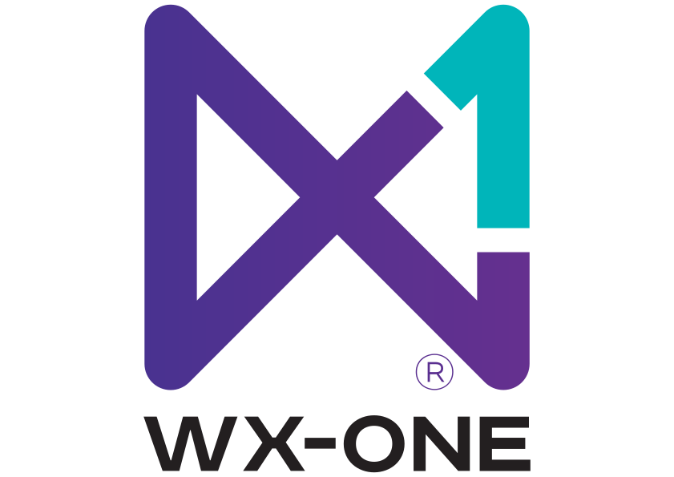
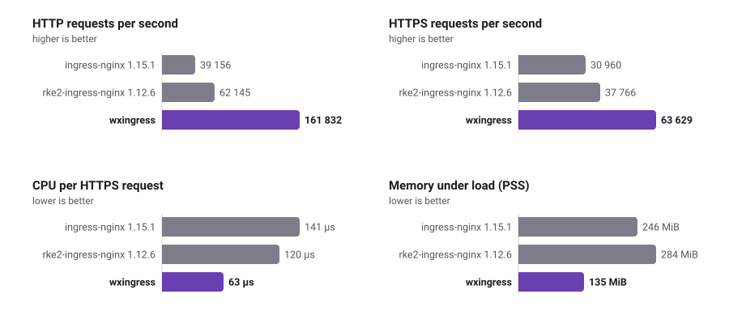

# wxingress

**The ingress-nginx successor that you can drop in: your Ingresses, annotations and ConfigMap as they are, served by NGINX Ingress Controller's core, without Lua, and with the Gateway API.**

[](https://github.com/wx-one/wxingress/actions/workflows/ci.yml)
[](https://wx-one.github.io/wxingress/)
[](LICENSE)
[](https://github.com/wx-one/wxingress/pkgs/container/wxingress)
[](https://github.com/sponsors/wx-one)

## Made by WX-ONE and WizardTales

<p>
  <a href="https://wx1.eu">
    <picture>
      <source media="(prefers-color-scheme: dark)" srcset="docs/assets/logos/wx-one-dark.svg">
      
    </picture>
  </a>
  &nbsp;&nbsp;&nbsp;
  <a href="https://wizardtales.com">
    <picture>
      <source media="(prefers-color-scheme: dark)" srcset="docs/assets/logos/wizardtales-dark.svg">
      
    </picture>
  </a>
</p>

wxingress is officially maintained by [WizardTales](https://wizardtales.com) and runs the ingress of
the [WX-ONE](https://wx1.eu) cloud platform. That is our commitment: it stays open source, and since we
depend on it ourselves, its development is secured. Donations are still very welcome and go
exclusively into its development: [sponsor wxingress](https://github.com/sponsors/wx-one).

## Why switch now: nginx2root

**ingress-nginx gets no fix for [nginx2root](https://blog.cloudflare.com/nginx2root/)** (CVE-2026-123007 and four
more, the worst remote code execution over HTTP/2). The project was retired in March 2026. wxingress takes over its
Ingresses unchanged and ships NGINX 1.31.9, which has the fixes. Four times the HTTP requests per second
of ingress-nginx, with half the memory ([benchmarks](#why-wxingress), [compared with the alternatives](#your-options-compared)).

## Are you affected?

```sh
kubectl get pods --all-namespaces --selector app.kubernetes.io/name=ingress-nginx
```

Any pod listed runs the retired controller.

## Quick start

```sh
helm install wxingress oci://ghcr.io/wx-one/charts/wxingress \
  --namespace wxingress --create-namespace \
  --set controller.ingressNginxCompat=true
```

`controller.ingressNginxCompat=true` is the ingress-nginx profile. With it, wxingress uses ingress-nginx's
defaults, updates endpoints dynamically and serves Ingresses without a host. It runs next to ingress-nginx,
so you can move traffic over step by step. To have wxingress serve the IngressClass `nginx` of an existing
ingress-nginx installation, read the [migration guide](https://wx-one.github.io/wxingress/migration/ingress-nginx/) first.

Images: `ghcr.io/wx-one/wxingress:<version>`, for example `5.7.1-wx11`. The image contains
NGINX 1.31.9 from nginx.org.

## What it is

The Kubernetes project retired [ingress-nginx](https://github.com/kubernetes/ingress-nginx) in March 2026.
Thousands of clusters still run it, with Ingresses full of `nginx.ingress.kubernetes.io/*` annotations.
wxingress takes those Ingresses unchanged. It is a fork of
[NGINX Ingress Controller](https://github.com/nginx/kubernetes-ingress) that reads ingress-nginx's
annotations, ConfigMap keys and IngressClass, uses ingress-nginx's defaults, and answers requests the way
ingress-nginx did. A test corpus of 97 real-world Ingresses gets the same answers to 2511 of 2562 probes;
each of the other 51 has a documented reason.

## Why wxingress

- **Drop-in for ingress-nginx.** It serves the IngressClass of controller `k8s.io/ingress-nginx` and
  Ingresses without a class, and reads the `nginx.ingress.kubernetes.io/*` annotations and the ingress-nginx
  ConfigMap keys. It speaks ingress-nginx's admission webhook semantics and exports ingress-nginx's
  Prometheus metrics, so dashboards and alerts keep working. The one thing it does not run is Lua in
  snippets: those move to [njs](https://wx-one.github.io/wxingress/migration/lua-to-njs/).
- **Faster, and lighter.** No Lua in the request path. Endpoints change without a reload, through a data
  plane module. Metrics are counted in shared memory instead of being shipped to a Go process per request.
  Measured on one node against the same 97 Ingresses:

  | | ingress-nginx 1.15.1 | wxingress |
  |---|---|---|
  | HTTP requests/s | 39 156 | **161 832** |
  | HTTP p99 latency | 4.69 ms | **0.60 ms** |
  | HTTPS requests/s | 30 960 | **63 629** |
  | CPU per HTTPS request | 141 µs | **63 µs** |
  | Memory under load | 246 MiB | **135 MiB** |
  | Controller CPU during endpoint churn | 28.8 s | **0.16 s** |

  

  How these numbers come about is described in [Testing and benchmarks](https://wx-one.github.io/wxingress/migration/testing/).
- **Gateway API.** Gateways with HTTPRoute, GRPCRoute, TLSRoute, TCPRoute and UDPRoute, and
  ReferenceGrants, on the same controller and the same data plane. The Gateway API semantics come from NGINX Gateway Fabric. It is tested (the Gateway API conformance suite and our own
  end-to-end tests) but does not run in production yet, unlike the Ingress side.
- **Everything NGINX Ingress Controller has.** VirtualServer, VirtualServerRoute, TransportServer, Policy
  and GlobalConfiguration resources, and the `nginx.org/*` annotations. The `jwt` and `oidc` Policies,
  which need NGINX Plus there, work with open-source NGINX in wxingress
  ([JWT and OIDC](https://wx-one.github.io/wxingress/user-guide/jwt-oidc/)).
- **Built for a careful switch.** Both controllers can serve the same Ingresses at the same time, node by
  node or address by address. There is a
  [runbook](https://wx-one.github.io/wxingress/migration/rke2/) for RKE2's bundled
  `rke2-ingress-nginx`, and a [values translator](https://wx-one.github.io/wxingress/migration/ingress-nginx/#translate-your-values)
  for an existing ingress-nginx Helm release.
- **Open source, European licence.** [EUPL-1.2](LICENSE). The Apache-2.0 code it is built on stays
  Apache-2.0, see [NOTICE](NOTICE).

## Your options, compared

As of November 2026:

| | ingress-nginx | **wxingress** | F5 NGINX Ingress Controller | Traefik | Gateway API controllers (NGINX Gateway Fabric, Envoy Gateway, …) |
|---|---|---|---|---|---|
| Security fixes | none since March 2026 | **yes** | yes | yes | yes |
| Your `nginx.ingress.kubernetes.io/*` annotations | yes | **yes, as they are** | no, `nginx.org/*` instead | many, through a compatibility provider | no, Ingresses are rewritten as routes |
| Your ingress-nginx ConfigMap and Helm values | yes | **yes** ([values translator](https://wx-one.github.io/wxingress/migration/ingress-nginx/#translate-your-values)) | no | no | no |
| ingress-nginx's Prometheus metrics | yes | **yes** | no | no | no |
| Gateway API | no | **yes** | no | yes | yes |
| Cost | free, but unmaintained | **free, open source (EUPL-1.2)** | free, open source | free, open source | free, open source |

F5 makes you choose between Ingress and the Gateway API: NGINX Ingress Controller serves Ingresses but not
the Gateway API, NGINX Gateway Fabric serves the Gateway API but not Ingresses. Two controllers, two
deployments, and moving from one to the other is a cut-over. wxingress serves both at once, on the same
address, so applications move to the Gateway API one at a time, when it suits them.

## Moving from ingress-nginx

For almost every cluster the switch is: install wxingress, point it at the IngressClass, move the traffic.
Ingresses, annotations and ConfigMap keys stay as they are. Things to look at before you switch:

- **Lua in snippets** (`configuration-snippet`, `server-snippet` with `access_by_lua_block`,
  `content_by_lua_block` and so on): there is no Lua in wxingress. Rewrite the logic in
  [njs](https://nginx.org/en/docs/njs/), NGINX's JavaScript. The [Lua to njs guide](https://wx-one.github.io/wxingress/migration/lua-to-njs/)
  shows how, with a worked example.
- **Snippet annotations** are off by default, as in ingress-nginx since 1.9.
- Annotations wxingress does not support log a warning on the Ingress. Those that would restrict access,
  such as ModSecurity or global auth, also log an error. The
  [annotation reference](https://wx-one.github.io/wxingress/reference/annotations/) lists every annotation
  and its status.

Read the full [migration guide](https://wx-one.github.io/wxingress/migration/ingress-nginx/).

## Documentation

**[wx-one.github.io/wxingress](https://wx-one.github.io/wxingress/)**: installation, the migration guide,
ingress-nginx compatibility, the Gateway API, reference pages for annotations, ConfigMap keys,
command-line flags and Helm values, and how to build and develop wxingress.

## Versions

A row for every release in which a component changed, newest first; each holds until the next row.

| wxingress | based on NGINX Ingress Controller | NGINX | Gateway API (via NGINX Gateway Fabric) |
|---|---|---|---|
| 5.7.1-wx11 and later | 5.7.1 | 1.31.9 | v1.7.0 (NGF 2.9.0) |
| 5.7.1-wx5 to 5.7.1-wx10 | 5.7.1 | 1.31.9 | v1.6.3 (NGF 2.8.1) |

`controller.gatewayAPI.installCRDs` installs the CRDs of the release's Gateway API version: from
5.7.1-wx11 those of v1.7.0, before that those of v1.6.3.

Every release comes with CycloneDX SBOMs of the binaries and of the image and names the image by its
digest; see [Releases and SBOMs](https://wx-one.github.io/wxingress/getting-started/installation/#releases-and-sboms).

The chart requires Kubernetes 1.25 or newer. wxingress is tested on Kubernetes 1.31 and 1.32, on RKE2 and kind.

## Commercial support

WizardTales offers support packages for organisations that run wxingress in production:

| Package | Price | Includes |
|---|---|---|
| **Fast release channel** | €1,000 per month per legal entity | targeted fixes for critical vulnerabilities from the WX-ONE emergency response team, ahead of the official release |
| **Emergency support desk** | €3,000 per month per legal entity | the fast release channel, plus an 8×5 emergency support desk with prioritised support; 24×7 on request |

Public releases are not held back: wxingress is usually released for everyone within about 24 to 48 hours
on working days. The fast release channel's emergency releases are not official releases, but targeted
fixes that close a critical gap until then. Order by email to
[support-ingress@wx1.de](mailto:support-ingress@wx1.de). A support package does not entitle you to demand
features. Details are on the [support page](https://wx-one.github.io/wxingress/about/support/).

## Contributing

Issues, discussions and pull requests are welcome. Read [CONTRIBUTING.md](CONTRIBUTING.md) first.
To report a security issue, follow [SECURITY.md](SECURITY.md) and do not open a public issue.

## Licence

wxingress is licensed under the [European Union Public Licence v. 1.2](LICENSE). It is a fork of NGINX
Ingress Controller and contains parts of NGINX Gateway Fabric, both Copyright F5, Inc. and licensed under
the [Apache License 2.0](LICENSES/Apache-2.0.txt). See [NOTICE](NOTICE).

NGINX is a registered trademark of F5, Inc. wxingress is not affiliated with or endorsed by F5, Inc. or the
Kubernetes ingress-nginx project.
