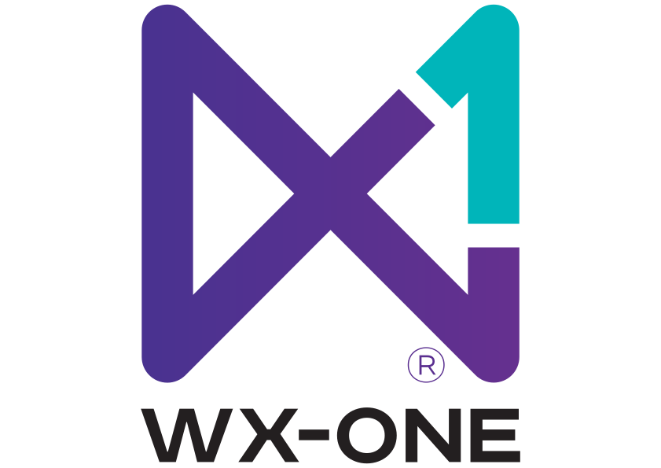
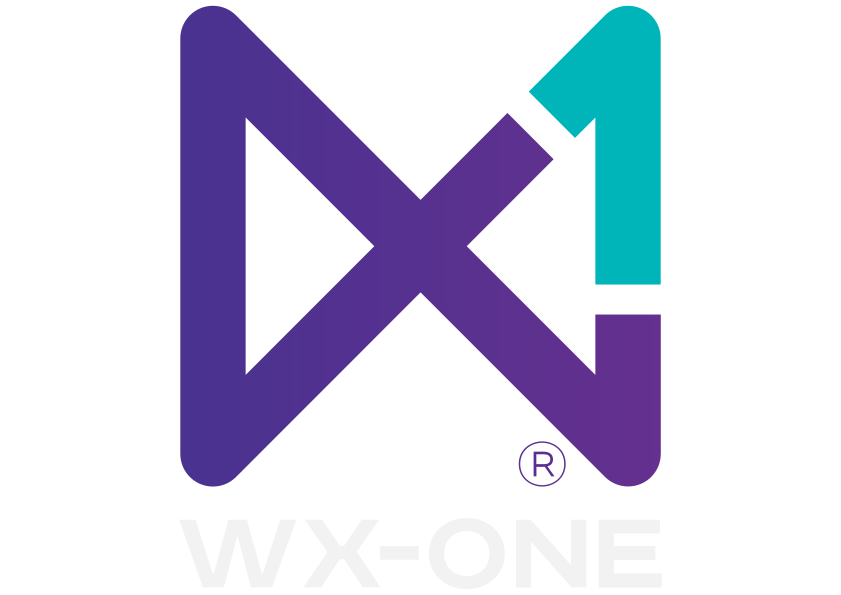

# Sponsors

wxingress is developed by [WizardTales](https://wizardtales.com) and powers the ingress of the
[WX-ONE](https://wx1.eu) cloud platform.

[{ .only-light }{ .only-dark }](https://wx1.eu)
[{ .only-light }{ .only-dark }](https://wizardtales.com)

## Sponsor wxingress

Keeping an ingress controller secure and compatible is ongoing work: every NGINX security release, every
upstream release of NGINX Ingress Controller and NGINX Gateway Fabric, every new Kubernetes version. If
your clusters depend on wxingress, please consider sponsoring it:

[:octicons-heart-fill-24: Sponsor on GitHub](https://github.com/sponsors/wx-one){ .md-button .md-button--primary }

Organisations that need guaranteed response times can buy a [support package](support.md) instead,
which also funds the project.
