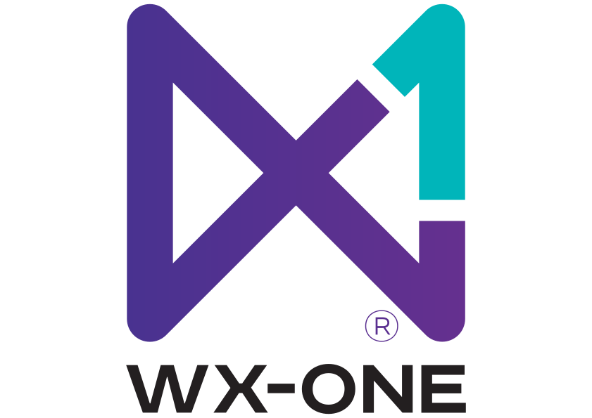
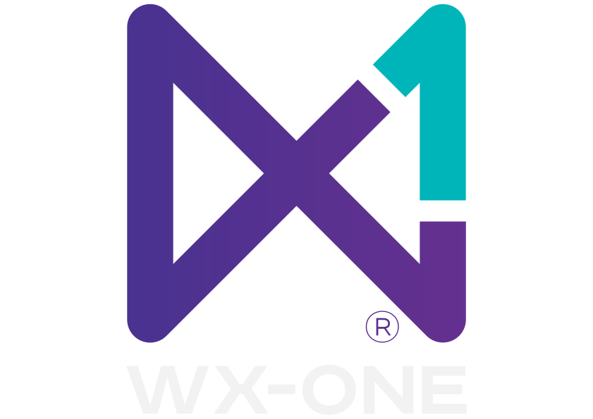
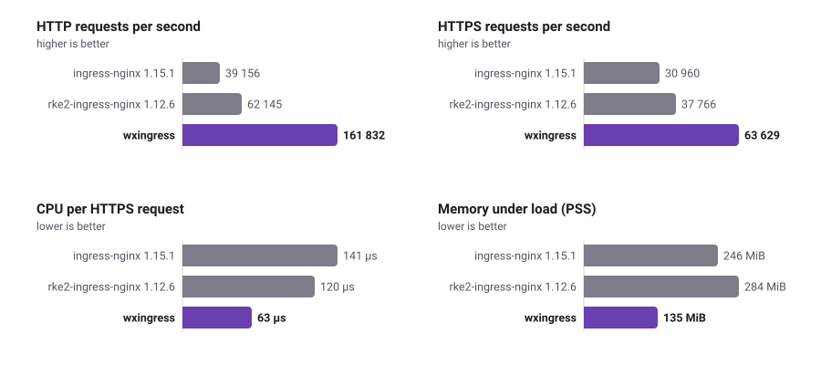

# wxingress

**The ingress-nginx successor you can drop in.** wxingress serves your Ingresses, your
`nginx.ingress.kubernetes.io/*` annotations and your ingress-nginx ConfigMap as they are. It is built on
NGINX Ingress Controller's core, runs no Lua, and adds the Gateway API.

[Install](getting-started/installation.md){ .md-button .md-button--primary }
[Migrate from ingress-nginx](migration/ingress-nginx.md){ .md-button }

## Made by WX-ONE and WizardTales

[{ .only-light }{ .only-dark }](https://wx1.eu)
[{ .only-light }{ .only-dark }](https://wizardtales.com)

wxingress is developed by [WizardTales](https://wizardtales.com) and runs the ingress of the
[WX-ONE](https://wx1.eu) cloud platform. It is open source under the [EUPL-1.2](about/license.md).
If your clusters depend on it, please [sponsor its development](https://github.com/sponsors/wx-one).

!!! tip "Commercial support"
    WizardTales offers support packages for production use: the **fast release channel** (targeted fixes for critical vulnerabilities
    from the WX-ONE emergency response team, ahead of the official release) for €1,000 per month and the **emergency support desk** (8×5, prioritised, 24×7 on request, including the fast
    release channel) for €3,000 per month, each per legal entity. Order by email to
    [support-ingress@wx1.de](mailto:support-ingress@wx1.de). [Details](about/support.md)

## Why it exists

The Kubernetes project retired [ingress-nginx](https://github.com/kubernetes/ingress-nginx) in March 2026.
Its Ingresses did not go away: they carry ingress-nginx's annotations, depend on its defaults (5 s connect
timeout, buffering off, three upstream retries, HSTS) and are written by Helm charts that will keep
writing them for years.

wxingress is a fork of [NGINX Ingress Controller](https://github.com/nginx/kubernetes-ingress) (NIC) that
teaches NIC ingress-nginx:

- It serves the IngressClass of controller `k8s.io/ingress-nginx` and Ingresses without a class.
- It reads ingress-nginx's annotations and ConfigMap keys and translates them into NIC's configuration.
- With `-ingress-nginx-defaults` it uses ingress-nginx's defaults wherever an Ingress sets nothing.
- Its admission webhook refuses what ingress-nginx's refuses.
- It exports ingress-nginx's Prometheus metrics, under ingress-nginx's names.

A request gets the same answer from wxingress as from ingress-nginx. The project checks this with a corpus
of 97 Ingresses from production clusters and popular Helm charts, probed 2562 ways. The details are in
[Testing and benchmarks](migration/testing.md).

## What you get

-   **Drop-in compatibility**

    ---

    Annotations, ConfigMap keys, IngressClass, defaults, admission checks and metrics of ingress-nginx.
    Unsupported annotations show up as Warning events on the Ingress, never silently.
    [Compatibility](user-guide/ingress-nginx-compatibility.md)

-   **No Lua, less CPU**

    ---

    About 4 times the HTTP requests per second of ingress-nginx, half the CPU per HTTPS request and half
    the memory under load. Endpoint changes need no reload and almost no controller CPU.

-   **Gateway API**

    ---

    Gateways with HTTPRoute, GRPCRoute, TLSRoute, TCPRoute and UDPRoute on the same controller. The Gateway API
    semantics (attachment, conflicts, status) come from NGINX Gateway Fabric. Tested against the conformance
    suite; not yet in our production. [Gateway API](user-guide/gateway-api.md)

-   **All of NGINX Ingress Controller**

    ---

    VirtualServer, VirtualServerRoute, TransportServer, Policy, GlobalConfiguration and the `nginx.org/*`
    annotations, with an open-source NGINX.

## Performance

Same node, same backends, same 97 Ingresses, each controller installed fresh as a hostPort DaemonSet with
four NGINX workers:

| | ingress-nginx 1.15.1 | rke2-ingress-nginx 1.12.6 | wxingress |
|---|---|---|---|
| HTTP requests/s | 39 156 | 62 145 | **161 832** |
| HTTP p50 / p99 | 1.68 / 4.69 ms | 0.93 / 4.54 ms | **0.38 / 0.60 ms** |
| HTTPS requests/s | 30 960 | 37 766 | **63 629** |
| CPU per HTTPS request | 141 µs | 120 µs | **63 µs** |
| Memory at rest / under load | 132 / 246 MiB | 134 / 284 MiB | **128 / 135 MiB** |
| Controller CPU during endpoint churn | 28.8 s | 42.3 s | **0.16 s** |
{ .hero-numbers }

The method, the raw numbers and where the difference comes from are in
[Testing and benchmarks](migration/testing.md#what-it-costs-the-benchmark).

## The one exception: Lua

ingress-nginx ran Lua: in its balancer, its metrics, and in snippets that users wrote. wxingress has no
Lua. Snippets that only contain NGINX directives keep working once snippets are enabled. Snippets with
`access_by_lua_block`, `content_by_lua_block` and the like need a rewrite in
[njs](https://nginx.org/en/docs/njs/), NGINX's JavaScript, which wxingress ships. The
[Lua to njs guide](migration/lua-to-njs.md) shows the patterns, with a complete example.
